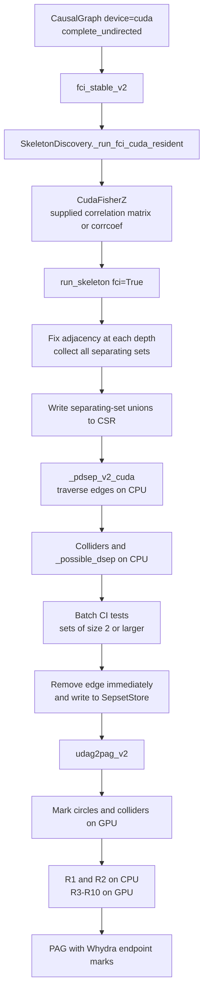

# FCI-stable on CUDA

**FCI-stable-cuda** (`algorithm=fci_stable_cuda`) is the CUDA mode of serial FCI-stable in [`fci_algo_v2.py`](../whydra/algorithms/standalone/fci_algo_v2.py). Use the CPU search with `n_jobs=1` as the reference. Compare the skeletons, separating sets, and final PAGs. [CPU and CUDA comparison guidelines](cuda.md).

The low-level entry point is `fci_stable_v2(cg, data, device="cuda")`. The public wrappers set `n_jobs=1`. Fisher-Z uses the fused skeleton kernel. For $\chi^2$, the degrees of freedom depend on the data in each stratum, so the algorithm batches the tests and uses a separate p-value calculation. Skeleton search stores the union of variables from the separating sets. Possible-D-SEP tests candidates for individual edges, starting with sets of size 2, and removes an edge as soon as a test establishes independence. R1 and R2 are interleaved in center traversal order.

For skeleton search, FCI uses the same matrix, correlation, and Fisher-Z routines as [PC-stable](pc_stable_cuda.md). In FCI, adjacency is fixed at each depth, the independence threshold is $p \geq \alpha$, and the implementation tracks `pMax` and uses FCI-specific rules for recording separating sets.

## Running the algorithm

Before running the example, [set up the CUDA environment](cuda.md). The example builds a PAG from data with a latent common cause.

```python
import numpy as np
from whydra import StandaloneFCIStable

rng = np.random.default_rng(42)
hidden, ex, ey, ez = rng.normal(size=(4, 1000))
x, y = hidden + ex, hidden + ey
data = np.column_stack([x, y, y + ez])
graph = StandaloneFCIStable(
    device="cuda",
    indep_test="fisherz",
    alpha=0.05,
    max_cond_set_size=2,
    m_max=2,
).run(data)
assert graph.graph_kind == "pag"
print([str(edge) for edge in graph.get_graph_edges()])
```

The CPU and CUDA modes of `StandaloneFCIStable` both use `fci_stable_v2`. To run on CUDA, pass `device="cuda"` in Python or select `algorithm=fci_stable_cuda` in Hydra.

---

## Execution model



**Graph representation.** The skeleton uses `int8` with `0/1` entries. Possible-D-SEP runs on CPU with standard Whydra marks, where `0` means no edge, `1` means an arrowhead, and `2` means a circle. The orientation kernels use the internal pcalg encoding with `0` for no edge, `1` for a circle, `2` for an arrowhead, and `3` for a tail. FCI returns a PAG with Whydra marks. A tail is `-1`, an arrowhead is `1`, and a circle is `2`.

**Independence criterion.** FCI uses $p \geq \alpha$. In the fused Fisher-Z kernel, this corresponds to $\sqrt{\mathrm{df}}\,\lvert Z\rvert \leq \tau$ (`ge_alpha=1`). Rounding may affect the decision when the p-value is close to the threshold.

**Launch configuration.** The main skeleton kernels use CUDA thread blocks (CTAs) of 256 threads, with one thread per test or vertex. The batched factorization uses additional configurations. FCI applies PAG rules with one block of 256 threads in Gauss-Seidel order. See the [skeleton kernel configurations](pc_stable_cuda.md).

---

## Function reference

### Search control

#### `StandaloneFCIStable.run` ([`wrappers.py`](../whydra/algorithms/wrappers.py))

This method belongs to the public Python wrapper, which you can configure through Hydra. It creates a `CausalGraph` and a `CIT` test, selects the device, sets `n_jobs=1` for CUDA, and calls `fci_stable_v2`. It converts the final PAG matrix to a `GeneralGraph`.

#### `fci_stable_v2` ([`fci_algo_v2.py`](../whydra/algorithms/standalone/fci_algo_v2.py))

Runs skeleton search on GPU, passes the skeleton to `pdsep_v2(..., ci_batcher=...)`, and orients the result with `udag2pag_v2`. Possible-D-SEP reuses the skeleton's batched test when available. During orientation, R1 and R2 run on CPU and R3&ndash;R10 run in CUDA kernels.

#### `SkeletonDiscovery._run_fci_cuda_resident` ([`skeleton.py`](../whydra/algorithms/standalone/skeleton.py))

Calls `run_skeleton(..., fci=True, G1_t=G.clone(), pmax=cg.pMax)`. `to_host=False` keeps adjacency on the GPU until the handoff to Possible-D-SEP. If the search goes beyond the fused kernel's depth limit, Python continues the search using batched conditional independence tests. FCI and [PC-stable](pc_stable_cuda.md) use the same operations to create the complete graph, compute correlations, and run batched Fisher-Z.

---

### Differences from the PC skeleton

Both algorithms use `run_skeleton`, `run_depth`, `_ci_stream`, and `ci_from_comb`.

| Operation | PC-stable-cuda | FCI-stable-cuda |
| --- | --- | --- |
| Candidate list | `G` adjacency at the start of the depth | The batched path uses a snapshot `G1`. After processing the depth, it updates the snapshot as $\mathrm{G1} \leftarrow G$. The native driver also fixes adjacency at each depth. |
| Removal criterion | $p > \alpha$ or $\mathrm{stat} < \tau$ | $p \geq \alpha$ or $\mathrm{stat} \leq \tau$ |
| Removal timing | After processing the depth | After processing the depth |
| `pMax` | Unused | Per-pair maximum p-values in `float64` |
| Separating sets | Union for both orderings of the vertex pair | The native kernel merges the sets for both orderings of each pair. The batched path accumulates unions by ordered pair and then mirrors the entries. |

#### `prefix_pmax` ([`graph_batch.cu`](../whydra/algorithms/graph_core/graph_batch.cu))

In the low-level batched path, the kernel processes one test per thread in blocks of 256. It converts partial correlations to p-values with `erfc` and atomically updates the maximum `pMax[x,y]`. The native driver uses `pmax_update_kernel` for the computed statistics. The batched $\chi^2$ test can accumulate maxima on CPU. Compare floating-point values with a tolerance and compare adjacency and separating sets separately.

#### `fci_last_writer_mirror`

Mirrors CSR ranges using integer tensor indexing. If both orders of a pair have an entry, the function copies the range from `max(x, y)` to both cells, matching a serial traversal in ascending `x` order. If only the smaller index has an entry, it uses that entry. Kernels that already write the same union range to both cells skip this conversion.

---

### Possible-D-SEP ([`cuda_pdsep.py`](../whydra/algorithms/graph_core/cuda_pdsep.py), [`pdsep.cu`](../whydra/algorithms/graph_core/pdsep.cu))

#### Main path using `_pdsep_v2_cuda` ([`fci_algo_v2.py`](../whydra/algorithms/standalone/fci_algo_v2.py))

The control loop runs on CPU. It first orients colliders using the skeleton's separating sets. It builds the candidate pool separately for each direction of a vertex pair using the current `amat`. `_possible_dsep` uses two traversal layers and caches semidirected reachability. `_side_order` determines which side to check first.

The loop enumerates separating sets from size 2 through `min(|pds|, m_max)`. It skips subsets contained entirely in `adj(a)` or `adj(b)`. Within each size, it follows `itertools.combinations` order. `_search_separator_batched` sends test batches to the Fisher-Z or $\chi^2$ adapter and picks the first set with $p \geq \alpha$.

The main loop checks edges in advance against a graph snapshot within the work budget. It stops processing the current batch as soon as it removes the first edge. It builds the next batch from the updated adjacency. Once the budget is exhausted, it checks edges one at a time. The separating set is recorded for both orderings of the pair in `SepsetStore`.

#### `SepsetStore`, `sepset_dict_to_csr`, and `sepset_csr_to_dict`

Separating sets are stored on CPU in a one-dimensional `int64` array `S` with ranges in `ranges[p,p,2]`. `write` appends new entries during Possible-D-SEP. The conversion functions translate between CSR and a Python dictionary.

#### `mark_colliders_qreach`, `qreach_all`, and `run_pdsep_ci`

The low-level Possible-D-SEP operations use pcalg-style adjacency traversal. `qreach_all` builds the candidate set for a vertex. `run_pdsep_ci` traverses pairs with fixed adjacency. `pdsep_commit_walk` records separating sets in processing order. `fci_stable_v2` searches for candidates by edge through `pdsep_v2`. During orientation, `udag2pag` calls `mark_colliders`.

#### `mark_colliders_kernel`

One block of 256 threads visits center vertices `y` in ascending order. For the current center, threads check vertices `x` and gather candidates. They write the endpoint marks after completing the pass for that center. The next center sees the previous center's updates. The kernel looks up vertices in `int64` CSR ranges and writes arrowhead `2` to the internal `int8 amat` matrix.

---

### `udag2pag` ([`cuda_udag2pag.py`](../whydra/algorithms/graph_core/cuda_udag2pag.py), [`udag2pag.cu`](../whydra/algorithms/graph_core/udag2pag.cu))

The endpoint values are `0` for no edge, `1` for a circle, `2` for an arrowhead, and `3` for a tail. Each rule uses one block of 256 threads to apply its results. The outer loop preserves serial index order. Inside the block, threads process candidates with a grid stride. Synchronization after each update preserves Gauss-Seidel order. Comparisons and writes use `int8` and `int32`.

#### `apply_udag2pag` and `apply_udag2pag_tensor`

Set circles on the remaining edges and orient colliders with `mark_colliders`. Rule passes repeat until the endpoint marks stabilize. With `r1r2_host`, each pass calls `_rules_r1_r2_cycle` on CPU. For each center, it applies R1 to both sides of a triple and then R2 in the same order. The GPU then applies R3&ndash;R10. Endpoint marks are converted from pcalg encoding to Whydra encoding before the CPU call and back afterward. `whydra_marks=True` returns standard Whydra encoding.

R3 packs pairs `(b,d)`. R4, R6, and R7 use this list. R5 collects circle-circle edges, and R8, R9, and R10 collect edges $a \mathbin{\ast\!\to} c$ with a circle at `a`. R4&ndash;R8 and R10 apply results sequentially because an orientation can affect subsequent tests. R9 traverses its packed candidates in serial order.

`apply_udag2pag_tensor` modifies an `int8` PAG tensor in place on the device. `apply_udag2pag` takes a NumPy matrix, copies it to the GPU, and copies the result back to CPU. The graph is a NumPy matrix after `_pdsep_v2_cuda`, so `fci_stable_v2` calls `apply_udag2pag`. Each R1/R2 pass transfers data to CPU.

#### `apply_r1` and `r1_kernel`

When R1 runs on its own, the packing kernels collect pairs with `pag[a,b]==2` and a nonzero reverse entry, in `(b,a)` order. The orientation kernel uses one block of 256 threads to check vertices `c` and place an arrowhead at `c` and a tail at `b`. Threads synchronize after processing each pair.

#### `apply_r2` and `r2_kernel`

When R2 runs on its own, the packing kernels collect pairs `(a,c)` with a circle at `pag[a,c]==1` and a nonzero reverse entry, in `(c,a)` order. A candidate qualifies when the current graph contains a directed chain that satisfies the rule. One block applies results in a 256-position window and writes `pag[a,c]=2`. The traversal preserves CPU order and skips previously checked pairs that lacked the required chain.

#### `apply_r3` and `r3_kernel`

Pack pairs `(b,d)` with a nonzero `pag[b,d]` and a circle in the reverse cell, in `(d,b)` order. One block of 256 threads uses a 256-position window and writes `pag[d,b]=2` when the pair has two unshielded parents.

#### `apply_r9` and `r9_apply_kernel`

Use the R8 pair list and check `minUncovPdPath` on the current graph in serial order. Writing the tail `pag[c,a]=3` ends the search for that pair and preserves the application order for the others.

#### `apply_r7` and `r7_kernel`

Use the R3 pairs. Threads search in parallel for `a` with `pag[b,a]==3` and a circle at `b`, then write `pag[c,b]=3` in serial order. A new tail can make an orientation possible for the next pair centered at `c`.

#### `apply_r8` and `r8_kernel`

Pack edges $a \mathbin{\ast\!\to} c$ with a circle at `a`. Threads check the conditions for R8 in parallel, then write `pag[c,a]=3` in serial order.

#### `apply_r10` and `r10_apply_kernel`

Use the R8/R9 list and apply results sequentially. A tail at `a` on an edge with `c` can make `a` a parent of `c`. The next check can use that parent.

#### `apply_r4` and `r4_apply_kernel`

Use the R3 pair list in `(c,b)` order. One block checks `minDiscPath` against the current graph in serial order until the first match. Applying the result replaces a circle and changes which paths are valid for later candidates.

#### `apply_r5` and `r5_apply_kernel`

Pack circle-circle edges in `(b,a)` order. Results are applied sequentially. New tails change the set of available circle edges and uncovered cycles.

#### `apply_r6` and `r6_kernel`

Use the R3 pair list. Threads look for undirected neighbors of `b`, then write `pag[c,b]=3` in serial order. A new undirected edge can make an orientation possible for the next pair.

---

## Limitations

FCI inherits the [PC-stable limitations](pc_stable_cuda.md#limitations) on dense $p \times p$ storage, supported sizes for the fused Fisher-Z and batched $LDL^\top$ kernels, numerical conditioning, and extension builds. The $\chi^2$ search uses the batched path.

**Single device.** The search uses the current GPU and one CUDA stream. Select the GPU before calling the algorithm.

**Background knowledge.** Any `background_knowledge` value other than `None`, including an empty object, raises `NotImplementedError` before search. Use CPU to search with background knowledge.

**Search depth.** `max_cond_set_size` caps conditioning-set size at every stage. `m_max` applies to Possible-D-SEP. With `m_max < 2`, that stage skips its CI tests. `use_pds_path=True` restricts candidates to the biconnected component of the edge under test. The default is `use_pds_path=False`.

**`pMax`.** CPU and CUDA may compute slightly different p-values. Compare the maxima with a tolerance. Compare adjacency and separating sets separately.

**Current adjacency in Possible-D-SEP.** A batch can only precompute against one snapshot. Once an edge is removed, the remaining candidates are checked against the updated graph.

**PAG orientation.** R1 and R2 run on CPU in reference order. R3&ndash;R10 run on the GPU in one block of 256 threads. Passes continue while endpoint marks change.

**Result.** The wrapper returns a Whydra `GeneralGraph` with standard PAG marks.
