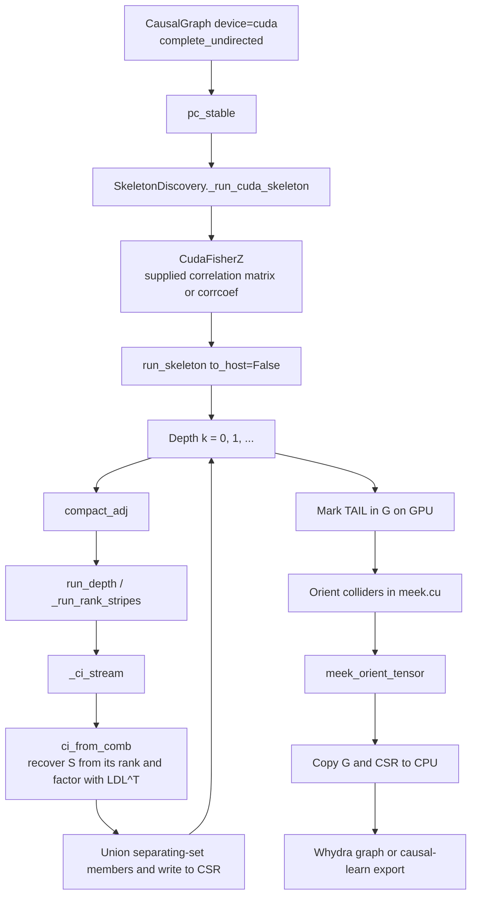

# PC-stable on CUDA

**PC-stable-cuda** (`algorithm=pc_stable_cuda`) is the CUDA implementation of serial PC-stable. Use the CPU search with `n_jobs=1` as the reference. Compare the skeletons, separating sets, and final CPDAGs. [CPU and CUDA comparison guidelines](cuda.md).

The low-level entry point `pc_stable(cg, device="cuda")` is defined in [`pc_algo.py`](../whydra/algorithms/standalone/pc_algo.py). The public wrappers set `n_jobs=1`. The implementation supports the Fisher-Z and $\chi^2$ conditional independence tests.

[FCI-stable on CUDA](fci_stable_cuda.md).

## Running the algorithm

Before running the example, [set up the CUDA environment](cuda.md). The example compares the final PC-stable graphs from CPU and GPU runs with the same search settings.

```python
import numpy as np
from whydra import StandalonePCStable

rng = np.random.default_rng(42)
x, z, noise = rng.normal(size=(3, 1000))
data = np.column_stack([x, x + z + noise, z])
options = {"alpha": 0.05, "indep_test": "fisherz", "max_cond_set_size": 2}
cpu = StandalonePCStable(device="cpu", n_jobs=1, **options).run(data)
gpu = StandalonePCStable(device="cuda", **options).run(data)
print(np.array_equal(cpu.graph, gpu.graph))
```

---

## Execution model

In the main CUDA path, the matrix stays on the GPU throughout skeleton search, collider orientation, and Meek's rules R1&ndash;R3. Fisher-Z takes the configured correlation matrix from `CIT` or computes it from the data. The public wrapper returns a Whydra graph. The low-level CUDA entry point can export the result to causal-learn.



**GPU tensors.** The `int8` adjacency matrix `G` holds `0/1` values until skeleton search finishes. It then holds tail and arrowhead marks. `C` is a $p \times p$ correlation matrix, stored as `float64` by default. Separating sets are accumulated in CSR format on the GPU. The CPU matrix `cg.G.graph` stays zero until the result is copied back.

**Independence criterion.** Serial PC treats variables as conditionally independent when $p > \alpha$. The fused Fisher-Z kernels use a strict comparison against the threshold $\tau = \Phi^{-1}(1 - \alpha / 2)$ (`ge_alpha=0`).

**Launch configuration.** Skeleton kernels that process one item per thread use CUDA thread blocks (CTAs) of 256 threads and a grid of `ceil(N / 256)` blocks. Batched Fisher-Z factorization uses the configurations in the table below. Work runs on PyTorch's current CUDA stream.

---

## Function reference

### Search control

#### `StandalonePCStable.run` ([`wrappers.py`](../whydra/algorithms/wrappers.py))

This is the public Python interface and Hydra configuration target. It creates `CausalGraph(..., device=...)` and a `CIT` for the selected test, sets `n_jobs=1` for CUDA, and calls `pc_stable`. The functions it calls launch the kernels.

#### `pc_stable` ([`pc_algo.py`](../whydra/algorithms/standalone/pc_algo.py))

Selects CPU or CUDA. In the main CUDA path, it passes the skeleton and CSR data to the collider orientation kernels and `meek_orient_tensor`. It copies the result to CPU. `SkeletonDiscovery.run()` builds the skeleton and marks the endpoints with tails.

#### `CausalGraph.__init__(..., device="cuda")` ([`causal_graph.py`](../whydra/algorithms/graph_core/causal_graph.py))

Calls `complete_undirected` and stores `cg._G_cuda`. Graph initialization creates no `Edge` objects. The CPU matrix `G.graph` stays zero.

#### `complete_undirected(p, device)` ([`cuda_graph_batch.py`](../whydra/algorithms/graph_core/cuda_graph_batch.py))

Creates a `(p, p)` `int8` tensor with ones off the diagonal. PyTorch fills the entries.

#### `SkeletonDiscovery._run_cuda_resident`

Calls `run_skeleton` with `G` on the GPU and then calls `_epilogue_from_device`. The native skeleton driver launches the fused kernel for $k \le 32$. If search must go deeper, the native driver reports the depth at which to hand off. The CPU continues enumerating combinations and calls `CudaFisherZ.batch` to test them in batches. The batched kernel runs on the GPU up to `k=96`. In the Python path through `run_skeleton`, depths 33&ndash;96 can run directly on the GPU through `fill_batch` and `CudaFisherZ.batch_r`.

#### `SkeletonDiscovery._epilogue_from_device`

Copies `G` to CPU. For the skeleton, it writes `Endpoint.TAIL` to nonzero cells in `cg.G.graph`. After orientation, it copies the final marks. It also copies the CSR arrays `sepset_S` and `sepset_ranges`.

---

### Correlation and Fisher-Z

#### `corrcoef_from_data` ([`cuda_fisher_z.py`](../whydra/algorithms/graph_core/cuda_fisher_z.py))

Copies $n \times p$ data to the GPU, centers the columns, and computes the Pearson correlation matrix $C = \frac{X^{\mathsf{T}} X}{\sigma \otimes \sigma}$, where $\sigma$ contains the norms of the centered columns. This is numerically equivalent to `np.corrcoef(data.T)`. Matrix multiplication on the GPU uses cuBLAS GEMM. Square roots and quotients are computed elementwise. The default is `float64`.

#### `CudaFisherZ.from_data` and `CudaFisherZ.__init__`

Keep `C` on the GPU and use the compiled `_whydra_fisher_z_ldlt` extension. `eps` sets diagonal regularization, as in the `NumpyFisherZ` CPU implementation.

#### `CudaFisherZ.batch_r`

Computes partial correlations `r` for a batch of `(x[b], y[b] | S[b])` tests. The indices use `int32`. `C` and `r` use `float64` by default. The `fisher_z_ldlt_batch` kernel chooses its work partition based on the conditioning-set size `k = |S|` and the number of tests `B`.

| `k` | Blocks | Threads per block | Threads per test | Computation |
| --- | --- | --- | --- | --- |
| 0&ndash;3 | `ceil(B / 256)` | 256 | 1 | Unrolled $LDL^{\mathsf{T}}$ factorization in registers |
| 4&ndash;8 | `ceil(B / 32)` | 256 | 8 | $LDL^{\mathsf{T}}$ factorization in shared memory |
| 9&ndash;16 | `ceil(B / 16)` | 256 | 16 | $LDL^{\mathsf{T}}$ factorization in shared memory |
| 17&ndash;96 | `ceil(B / tests_per_cta)` | $32 \times \texttt{tests\_per\_cta}$ (up to 256) | 32 | The block size is chosen so the $k \times k$ matrix fits in the allocated shared memory |

Threads load `C[i,j]` through `__ldg` using the matrix strides. They factor $C[S,S] = L D L^{\mathsf{T}}$ without pivoting, solve two unit lower triangular systems, and obtain the partial correlation $r = \frac{q_{xy}}{\sqrt{\lvert q_{xx} q_{yy} \rvert}}$. The fused `ci_from_comb` kernel performs the factorization without building a separate `(x, y, S)` buffer. [`fisher_z_ldlt.cu`](../whydra/algorithms/graph_core/fisher_z_ldlt.cu).

#### `CudaFisherZ.batch`

Converts GPU partial correlations to p-values with `erfc` on CPU. If the conditioning set exceeds the kernel's size limit, the batch runs on CPU. For the unregularized test, the adapter uses the configured `CIT` whenever computation falls back to CPU. [Fisher-Z adapter](../whydra/algorithms/graph_core/cpu_cuda_fisher_bridge.py).

#### `_p_value_from_r`

Converts a partial correlation to a p-value on CPU with `float64` arithmetic. The fused CUDA kernel compares the statistic with the z threshold.

---

### Skeleton (`graph_batch.cu` and `cuda_graph_batch.py`)

The main kernels use 256 threads per block and a grid of `ceil(N / 256)` blocks, where `N` is the number of vertices, pairs, or tests. Each thread processes one item. Combination ranks and adjacency use integer types `int32`, `int64`, and `int8`. Fisher-Z factorization in the fused kernel uses `float64` by default. [Kernel source](../whydra/algorithms/graph_core/graph_batch.cu).

#### `compact_adj` &rarr; `degrees` and `compact`

Compacts neighbor lists in ascending index order, like `np.where`. `degrees_kernel` scans each `int8 G` row with one thread per vertex and writes its degree as `int32`. `compact_kernel` also uses one thread per vertex and writes the neighbors to `nbrs[p, max_d]`.

#### `emit_pairs`

Uses one thread for each vertex `x` and writes an ordered pair `(x, y)` for each compacted neighbor.

#### `count_tests`

Uses one thread per ordered pair to compute $\binom{\deg(x) - 1}{k}$ as `int64`. It records `-1` on overflow.

#### `fill_batch` and `fill_at_ranks`

Recover the conditioning set `S` from its rank and write it to a `(B, k)` `int32` buffer. The Python skeleton path uses these functions, for example, at $33 \le k \le 96$ or when fusion is disabled. The fused PC path handles $k \le 32$ without this buffer.

#### `_ci_stream` and `ci_from_comb`

The fused path for $k \le 32$ uses one thread per test and a batch size of approximately $E_{\mathrm{live}} \cdot W$, where $W = \max(1, 2^{20} / E_{\mathrm{live}})$.

1. Binary search over `offsets` finds pair `e`.
2. `unrank_lex` reconstructs the conditioning set `S` in registers.
3. $LDL^{\mathsf{T}}$ factorization computes the partial correlation.
4. The kernel compares $\sqrt{\mathrm{df}}\,\lvert Z \rvert$ against $\tau$.
5. In first-hit mode, `atomicMin` records the smallest local rank in `first_rank[e]`.
6. In PC union mode, each test that finds independence writes `union_marks[row, Sloc[j]] = 1` and `hit_flags[row] = 1`. The `rows` mapping associates each batch with a mask row at the current depth.

PC runs with `write_g=0`. `G` stays fixed until the search finishes the current depth.

#### PC-stable separating-set unions

With `stable=True`, PC checks every conditioning set at the current depth for a separated pair. It stores the union of their variables from both orderings of the pair, `(x, y)` and `(y, x)`. The entry is accessible at both symmetric indices. Collider orientation checks whether the center vertex belongs to this union.

- In the batched path, `run_depth` allocates a mask of shape `[E0, p]` and flags of shape `[E0]`. `E0` is the number of ordered pairs under consideration at the current depth.
- Each test that finds independence marks the pair's row on the GPU. $\chi^2$ and other batched paths set these marks with PyTorch operations.
- After finding the first separating set for a pair, the search keeps testing that pair through the end of the current depth.
- `SepsetCSR.commit_union` appends the sorted union to CSR with symmetric ranges. `apply_hits` removes the edges.

`SepsetCSR.claim` and `claim_sepsets_kernel` reserve `ranges[x,y]` through `atomicCAS` and write the set with the lowest rank that establishes independence into one-dimensional `S`. Diagnostics and some low-level paths use this mode. At depth 0, the native skeleton uses it to record the empty separating set. At higher depths, stable PC and FCI skeleton search take the union of the separating sets. [FCI Possible-D-SEP](fci_stable_cuda.md) chooses the first qualifying separating set on the current graph.

#### `apply_hits`, `delete_if_indep`, and `edge_present`

Process one pair per thread. Writing zero to an `int8` cell is idempotent, so edge removal needs no atomic operation.

#### `hits_from_r` and `first_hit_ranks`

In the batched path, they compute an independence flag from a `float64` partial correlation and find the lowest local rank. The fused PC path does this inside `ci_from_comb`.

#### `run_depth`

Iterates over batches of ranks at a fixed depth `k` on CPU. PC enumerates $\operatorname{combinations}(\operatorname{nbrs}(x) \setminus \{y\}, k)$, combines the variables of separating sets with `commit_union`, and clears cells in `G` according to the flags after processing the depth.

#### `run_skeleton`

Iterates over depths $k = 0, 1, \ldots$ while at least one pair has enough neighbors for a test and the depth stays within the limit. For Fisher-Z, if `pc_skeleton_union` is available, the C++ extension runs the loop, compacts adjacency, evaluates tests, and writes CSR. The Python path compacts adjacency at each depth and calls `run_depth`. With `to_host=False`, the matrix and CSR data stay on the GPU for the next phase.

#### `pack_sepset_csr` and `fci_last_writer_mirror`

`pack_sepset_csr` combines the hit tensors into CSR. `fci_last_writer_mirror` applies the FCI mirroring rules.

---

### After skeleton search

#### `orient_colliders_tensor` ([`meek_torch.py`](../whydra/algorithms/graph_core/meek_torch.py))

Marks unshielded colliders in the GPU matrix using CSR separating sets. The kernel launches one block of 256 threads. For each center `j` visited in `find_unshielded_triples` order, the threads check neighbor combinations and gather candidates. An unshielded triple qualifies when it has a recorded separating set that excludes `j`. After `__syncthreads`, thread 0 applies the marks in `uc_priority=2` order. The next center sees the arrowheads already assigned.

#### Cycle checks in Meek's rules

On CPU, `_orient_edge_conflict_aware` skips orientation $\mathrm{src} \to \mathrm{tgt}$ when the edge is undirected and `tgt` is already an ancestor of `src` along fully directed edges. In `meek.cu`, `orient()` also calls `reaches_directed` before writing the mark. Each thread has a queue row and a visited row in global memory. Each array uses $256 \times p$ elements in total. For R1, threads orient outgoing edges for one center `j`, preserving reachability decisions for that center.

#### `meek_orient` ([`meek_torch.py`](../whydra/algorithms/graph_core/meek_torch.py))
#### `meek_kernel` ([`meek.cu`](../whydra/algorithms/graph_core/meek.cu))

Apply R1&ndash;R3 in place to an `int8` endpoint matrix with `-1` for a tail and `1` for an arrowhead. Several blocks pack the neighbor lists. One block of 256 threads then applies the rules in Gauss-Seidel order.

- **R1.** Unshielded pairs `(i,k)` at center `j` are packed into CSR with index `v_off[j]`. Threads work in parallel within a center and call `__syncthreads` afterward.
- **R2.** Triples `i<j<k` are packed once. Within a 256-entry window in shared memory, the thread owning the index processes the first eligible triangle. The window is refilled and the remaining candidates are checked again.
- **R3.** Quadruples `(i,j,k,l)` are packed in `find_kites` order. The thread for the first eligible candidate writes $i \to l$. The window is refilled as in R2, and the remaining candidates are checked again.

The kernels apply each mark immediately to match the order of serial `find_unshielded_triples`, `find_triangles`, and `find_kites`. Comparisons use integers and writes use `int8`. Adjacency remains fixed.

#### `_cl_dpath` and `to_causallearn_graph` ([`cpu_graph_convert.py`](../whydra/algorithms/graph_core/cpu_graph_convert.py))

The export sets `cl.graph = G.T` and computes the ancestor-reachability matrix `dpath`. If the oriented matrix is still on the GPU, it computes `dpath` there. The public PC wrapper returns a Whydra graph without exporting it.

---

## Limitations

**Statistical model and data.** Fisher-Z assumes complete, continuous Gaussian data. Use $\chi^2$ for discrete data. The CUDA $\chi^2$ adapter encodes categorical values as `uint16` and supports up to 1023 categories per variable. Fisher-Z with `k` conditioning variables requires $n - k - 3 > 0$. Degenerate columns can produce `NaN` in the correlation matrix. CPU comparisons use `float64` by default. Set `WHYDRA_ENABLE_FLOAT32=1` at build time to compile `float32` kernels.

**Background knowledge.** Any `background_knowledge` value other than `None`, including an empty object, raises `NotImplementedError` before search. Use CPU to search with background knowledge.

**Search depth.** `max_cond_set_size` caps the conditioning-set size `k`.

**Stable order.** `stable=False` raises `ValueError`. Use serial CPU PC for the non-stable variant. The public wrappers accept `uc_rule=0` and `uc_priority=2`.

**Device and execution.** A CUDA-enabled build of PyTorch is required. The algorithm uses the current GPU, one CUDA stream, and `n_jobs=1`. Select the device beforehand and pass `device="cuda"`.

**Conditioning-set size and combination count.** The fused $LDL^{\mathsf{T}}$ kernel supports $k \le 32$. `CudaFisherZ` factors blocks up to $96 \times 96$ in shared memory. The batched path supports depths 33&ndash;96 through `fill_batch` and `batch_r`. After depth 32, the native skeleton driver hands further enumeration to Python. For sizes above 96, the batched adapter runs on CPU. The combination count `C(n, k)` must fit in `int64` or the algorithm raises `OverflowError`. Factorization without pivoting is sensitive to poor conditioning of `C[S,S]`.

**Memory.** The `int8` adjacency, correlation matrix, and separating-set ranges use dense arrays. The `int64` array `ranges[p,p,2]` takes about $16p^2$ bytes. The CSR buffer grows during search. When allocation fails, `RuntimeError` reports the buffer name, required memory, and available GPU memory. The search starts from a complete graph.

**Orientation and result transfer.** Collider orientation and Meek's rules each use one block of 256 threads. On large graphs, this limits GPU utilization. During GPU search, the CPU matrix `cg.G.graph` remains zero, so inspecting `Edge` objects before the copy back does not show the current adjacency.

**Fisher-Z threshold.** CUDA compares the statistic with a threshold. Rounding near `alpha` can change the independence decision, skeleton, and separating sets.
