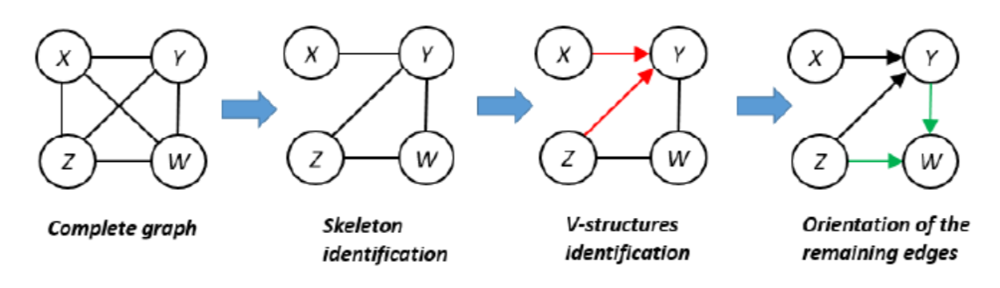

.. _constraint-based:

Алгоритмы constraint-based Causal Discovery
=============================================

Constraint-based методы представляют класс алгоритмов, которые восстанавливают
причинно-следственную структуру графа, опираясь на тесты условной независимости
между переменными. В отличие от score-based подходов, которые формулируют Causal
Discovery как задачу оптимизации некоторой целевой функции, constraint-based методы
последовательно исключают невозможные связи, используя статистические закономерности
независимости, наблюдаемые в данных.

Основная идея заключается в том, что каждая причинная структура накладывает
специфический набор ограничений (constraints) на совместные распределения переменных.
Если две переменные оказываются условно независимыми при определённом наборе
контролируемых переменных, то между ними не может быть прямой причинной связи —
это лежит в основе исключения рёбер.

Constraint-based методы хорошо изучены теоретически, обладают строгими гарантиями
корректности при выполнении предпосылок (например, **faithfulness assumption**: если
две переменные не связаны причинно-следственной связью, они не должны быть статистически
зависимыми) и являются одними из наиболее распространённых методов структурного обучения
причинно-следственных графов.

.. _alg-pc:

Алгоритм PC (Peter-Clark)
---------------------------

PC является одним из наиболее известных и фундаментальных constraint-based
методов [spirtes2000causation]. Работа алгоритма начинается с полного графа,
содержащего ребро между каждой парой переменных, и затем последовательно удаляет те
связи, для которых обнаружена условная независимость.

После этапа восстановления «скелета» графа PC использует набор детерминированных
правил ориентации рёбер (orientation rules), позволяющих выявлять V-структуры и
частично восстанавливать направления причинных связей. Результатом работы алгоритма
является **CPDAG** (Completed Partially Directed Acyclic Graph) — граф, который
содержит как направленные, так и ненаправленные ребра и представляет собой весь класс
эквивалентности DAGs, которые неразличимы по наблюдаемым данным.

PC эффективен, теоретически обоснован и хорошо работает в условиях, когда все
причинные факторы наблюдаются и латентных переменных нет.

Обозначения
~~~~~~~~~~~~~~~~~~

- :math:`Adj(X)` — множество переменных, смежных с :math:`X` в текущем графе.
- :math:`CI(X, Y \mid S)` — тест условной независимости переменных :math:`X` и :math:`Y` при фиксированном множестве условий :math:`S`.
- :math:`SepSet[X, Y]` — разделяющее множество (separating set), при котором :math:`X` и :math:`Y` оказались независимыми.
- **CPDAG** — класс эквивалентности DAG, представленный частично ориентированным графом.

Псевдокод алгоритма PC
~~~~~~~~~~~~~~~~~~~~~~~~~~~~~~~~~~

| **Вход:** переменные :math:`V`, данные :math:`D`, тест условной независимости :math:`CI(\cdot)`
| **Выход:** частично направленный ацикличный граф (CPDAG) :math:`G`

**Шаг 1: Инициализация полного ненаправленного графа**

.. code-block:: text

   G ← полный граф над V
   Для всех пар (X, Y):
       SepSet[X, Y] ← ∅

**Шаг 2: Идентификация скелета**

.. code-block:: text

   l ← 0
   changed ← false
   Пока существует смежная пара (X, Y) с |Adj(X) \ {Y}| ≥ l:
       Для всех подмножеств S ⊆ Adj(X) \ {Y} с |S| = l:
           Если CI(X, Y | S) выполняется:
               Удалить ребро X — Y из G
               SepSet[X, Y] ← S
               SepSet[Y, X] ← S
               changed ← true
               break
       Если changed:
           l ← l + 1
           changed ← false

**Шаг 3: Идентификация V-структур**

.. code-block:: text

   Для всех троек (X, Z, Y) таких, что X и Z смежны с Y,
   но X—Y и Y—Z не смежны:
       Если Y ∉ SepSet[X, Z]:
           Ориентировать X — Y как X → Y
           Ориентировать Z — Y как Z → Y

**Шаг 4: Ориентация остальных рёбер**

.. code-block:: text

   Применить правила Мика (Meek's rules) для ориентации
   всех рёбер, которые могут быть ориентированы.
   Вернуть G

.. _alg-fci:

Алгоритм FCI (Fast Causal Inference)
------------------------------------------------------

Fast Causal Inference (FCI) расширяет возможности PC-алгоритма и предназначен для
ситуаций, когда в данных присутствуют **латентные переменные** или **selection bias**
[spirtes2001anytime]. В таких условиях стандартные CPDAG-графы оказываются
недостаточными, и FCI выводит более общий объект — **PAG** (Partial Ancestral Graph),
который может выражать различные уровни неопределённости относительно направлений рёбер
и наличия скрытых причин.

PAG — граф, который представляет класс эквивалентности причинных структур в условиях
наличия латентных confounding-факторов и selection bias.

Преимущество FCI заключается в его универсальности: в отличие от PC, он допускает
существование ненаблюдаемых переменных и способен выявлять структуры, отражающие
скрытые зависимости. Это делает его одним из наиболее гибких алгоритмов Causal Discovery
в реальных задачах.

.. _tab-pc-vs-fci:

Сравнение алгоритмов PC и FCI
------------------------------

.. list-table:: Сравнение алгоритмов PC и FCI
   :header-rows: 1
   :widths: 27 36 37

   * - Критерий
     - PC
     - FCI
   * - Тип выводимого графа
     - CPDAG
     - PAG (учёт латентных переменных и selection bias)
   * - Latent confounders
     - Не моделирует скрытые переменные
     - Корректно учитывает скрытые переменные
   * - Selection bias
     - Не учитывает
     - Учитывает
   * - Корректность при скрытых переменных
     - Некорректен (ложные направления, пропуск v-структур)
     - Корректен
   * - Вычислительная сложность
     - Ниже, значительно быстрее
     - Выше (расширенные CI-тесты, дополнительные правила ориентации)
   * - Чувствительность к ошибкам CI-тестов
     - Ниже
     - Выше (накопление ошибок)
   * - Стабильность результата
     - Умеренная
     - Ниже при больших размерностях (слишком много CI-тестов)
   * - Когда использовать
     - Все переменные наблюдаемы, мало переменных
     - Подозрение на скрытые переменные или selection bias

.. _alg-gfci:

Алгоритм GFCI (Greedy Fast Causal Inference)
------------------------------------------------------

Greedy Fast Causal Inference (GFCI) относится к гибридным алгоритмам, но в
значительной степени опирается на constraint-based логику [ogarrio2016hybrid].
Он сначала использует score-based поиск, затем constraint-based refinement, т.е.
сочетает тесты условной независимости с оценкой качества ограниченного пространства
графов, что позволяет одновременно учитывать как статистические зависимости, так и
ограничения структуры.

GFCI выводит **PAG-графы**, как и FCI, и способен работать в ситуациях со скрытыми
переменными, располагая при этом более высокой устойчивостью к шуму.

GFCI часто демонстрирует более высокую точность в условиях сложной структуры
зависимостей или небольших выборок, благодаря комбинации constraint-based принципов
и элементов score-based оценки.

.. _alg-pc-stable:

Алгоритмы PC-stable и FCI-stable
------------------------------------------------------

Алгоритмы PC, FCI и RFCI при высокоразмерных данных нестабильны — выход этих
алгоритмов может существенно зависеть от произвольного порядка, в котором переменные
представлены алгоритму, что приводит к высоковариабельным и потенциально ненадежным
результатам. Для решения этой проблемы предложены модифицированные алгоритмы
**PC-stable** и **FCI-stable** (Colombo et al. [colombo2014order]).

Проблема порядко-зависимости
~~~~~~~~~~~~~~~~~~~~~~~~~~~~~~~~~~

Оригинальный PC-алгоритм состоит из трех основных шагов:

1. Поиск смежности (оценка скелета)
2. Определение V-структур
3. Ориентация остальных рёбер с помощью правил

Порядко-зависимость возникает на каждом из этих шагов в версии для выборки,
когда условная независимость проверяется с помощью статистических тестов.

   Последовательность действий в алгоритме Peter-Clark

Модификация PC-stable
~~~~~~~~~~~~~~~~~~~~~~~~~~~~~~~~~~

Основная модификация в PC-stable касается первого шага — поиска скелета. В оригинальном
PC-алгоритме граф скелета обновляется немедленно после удаления каждого ребра. Это
означает, что наборы смежности (adjacency sets) для оставшихся переменных изменяются
в процессе выполнения цикла на данном уровне (размера условного множества).

Алгоритм PC-stable решает эту проблему путём введения **буферизации обновлений скелета**.
На каждом уровне алгоритм сначала вычисляет и сохраняет наборы смежности для всех
переменных. Затем, в процессе проверки условных независимостей, рёбра помечаются на
удаление, но фактические удаления происходят только после того, как все проверки для
данного уровня завершены.

Модификация FCI-stable
~~~~~~~~~~~~~~~~~~~~~~~~~~~~~~~~~~

FCI-stable — это модификация, которая применяет принцип стабильности PC-stable к FCI:

- Первоначальный скелет оценивается с помощью PC-stable, что обеспечивает порядко-независимую основу.
- Для дальнейшего снижения порядка-зависимости в определении V-структур может быть использован **консервативный подход** или **правило большинства**, которые оценивают все возможные разделяющие множества для неэкранированной тройки.

PC-stable и FCI-stable решают проблему воспроизводимости в причинно-следственном
анализе. Они сохраняют вычислительную эффективность и теоретические гарантии
(согласованность в высокоразмерных настройках) своих оригинальных аналогов, но при
этом обеспечивают значительно более стабильные и надежные результаты на реальных
данных. Эти алгоритмы реализованы в R-пакете ``pcalg``.

.. _alg-rai:

Алгоритм RAI (Recursive Autonomy Identification)
------------------------------------------------------

Алгоритм Recursive Autonomy Identification (RAI) относится к типу constraint-based
[yehezke2009bayesian]. Его ключевая инновация заключается в рекурсивном сочетании
трёх операций:

1. Проверки условной независимости (CI)
2. Ориентации рёбер
3. Декомпозиции структуры на автономные подструктуры

В отличие от классических constraint-based алгоритмов (PC), которые сначала строят
неориентированный граф, а затем ориентируют рёбра, RAI выполняет эти процессы
**параллельно и рекурсивно** с самого начала.

Этап 1: CI-тесты и удаление рёбер
~~~~~~~~~~~~~~~~~~~~~~~~~~~~~~~~~~

Алгоритм начинает с полного неориентированного графа. CI-тесты выполняются
последовательно, начиная с низких порядков (малые условные множества) и постепенно
увеличивая порядок (большие условные множества). Это позволяет сначала использовать
самые надежные тесты. Если проверка показывает, что две переменные условно независимы
при данном множестве, ребро между ними удаляется.

Этап 2: Ориентация рёбер
~~~~~~~~~~~~~~~~~~~~~~~~~~~~~~~~~~

Ориентация выполняется не после, а **в процессе** проверки независимости, как только
появляется достаточно информации. Используются стандартные правила ориентации: сначала
идентифицируются V-структуры (коллайдеры), а затем применяются индуктивные правила для
ориентации остальных рёбер (при этом избегая создания циклов и новых V-структур).

Этап 3: Декомпозиция на автономные подструктуры
~~~~~~~~~~~~~~~~~~~~~~~~~~~~~~~~~~~~~~~~~~~~~~~~~~~~~

После этапов CI-тестов и ориентации граф декомпозируется на меньшие, **автономные**
подструктуры. Автономная подструктура — это часть графа, которая содержит всех
родителей для своих узлов (удовлетворяет марковскому свойству внутри себя). Она может
быть выделена при наличии экзогенных причин (внешних родителей).

Декомпозиция основана на частичном топологическом порядке, полученном после ориентации
рёбер. Выделяются подструктуры предков (ancestor) и потомков (descendant). Алгоритм
рекурсивно применяется к каждой выделенной автономной подструктуре.

.. note::

   Основное преимущество RAI — существенно меньшая вычислительная сложность, чем в
   других CD-алгоритмах, из-за существенного сокращения количества необходимых CI-тестов.
   В худшем случае сложность сравнима с алгоритмом PC.
