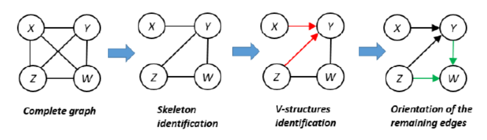

.. _constraint-based:

Constraint-based causal discovery
=================================

Constraint-based methods use conditional independence (CI) tests to estimate
causal structure. They remove an edge when a test indicates conditional
independence. Score-based methods select structures that optimize a chosen
criterion.

The causal Markov condition connects the graph structure to the distribution.
If a set of variables d-separates two nodes in the DAG, the corresponding
variables are conditionally independent given fixed values of the variables
in that set. **Faithfulness** gives the converse. Every conditional independence
in the distribution corresponds to a d-separation in the graph. Under these
assumptions, nonadjacent variables can depend on each other through an indirect
path or a common cause.

Guarantees of exact recovery in the oracle setting assume reliable knowledge
of conditional independencies. With a finite sample, the algorithm relies on
conditional independence tests. Test errors can change the skeleton and edge
orientations.
`Colombo et al. (2012) <https://arxiv.org/abs/1104.5617>`_.

.. _alg-pc:

PC (Peter-Clark)
----------------

PC starts with a complete undirected graph and removes edges in sequence when
a conditional independence test finds a separating set.
`Spirtes, Glymour, and Scheines, Causation, Prediction, and Search <https://mitpress.mit.edu/9780262527927/causation-prediction-and-search/>`_.

After building the skeleton, PC identifies v-structures and uses deterministic
orientation rules to recover some causal directions. It returns a **CPDAG**
(Completed Partially Directed Acyclic Graph), which represents a class of
Markov-equivalent DAGs that imply the same conditional independencies. A
directed edge has the same orientation in every DAG in the class. An
undirected edge can have different orientations in different DAGs in the class.

Standard PC assumes causal sufficiency, meaning that there are no hidden
common causes of observed variables. It also assumes no selection bias.

Notation
~~~~~~~~

- :math:`Adj(X)` is the set of variables adjacent to :math:`X` in the current graph.
- :math:`CI(X, Y \mid S)` tests whether :math:`X` and :math:`Y` are conditionally independent given :math:`S`.
- :math:`SepSet[X, Y]` is a separating set for which the test treats :math:`X` and :math:`Y` as conditionally independent.
- A **CPDAG** is a partially directed graph representing a Markov equivalence class of DAGs.

PC pseudocode
~~~~~~~~~~~~~

| **Inputs** Variables :math:`V`, data :math:`D`, and conditional independence test :math:`CI(\cdot)`
| **Output** A completed partially directed acyclic graph (CPDAG) :math:`G`

Basic PC removes an edge as soon as it finds a separating set.
:ref:`PC-stable <alg-pc-stable>` uses a snapshot of the adjacency sets at each
depth of the skeleton search.

**Step 1. Initialize a complete undirected graph**

.. code-block:: text

   G <- complete graph on V
   For every pair (X, Y):
       SepSet[X, Y] <- unset

**Step 2. Find the skeleton**

.. code-block:: text

   l <- 0
   While there is an ordered adjacent pair (X, Y) with |Adj(X) \ {Y}| >= l:
       For each ordered pair (X, Y) adjacent at the start of this depth:
           If X and Y are no longer adjacent, skip this pair
           For each S subset of Adj(X) \ {Y} with |S| = l:
               If CI(X, Y | S) indicates conditional independence:
                   Remove edge X - Y from G
                   SepSet[X, Y] <- S
                   SepSet[Y, X] <- S
                   Stop enumerating S for this pair
       l <- l + 1

**Step 3. Identify v-structures**

.. code-block:: text

   For each triple (X, Y, Z) where X is adjacent to Y, Y is adjacent to Z,
   and X and Z are nonadjacent:
       If SepSet[X, Z] is set and Y not in SepSet[X, Z]:
           Orient X - Y as X -> Y
           Orient Z - Y as Z -> Y

**Step 4. Orient the remaining edges**

.. code-block:: text

   Apply Meek's rules to orient every edge that can be oriented.
   Return G

.. _alg-fci:

Fast Causal Inference (FCI)
---------------------------

Fast Causal Inference (FCI) allows for **hidden common causes** and
**selection bias** in the causal model. It returns a **PAG** (partial
ancestral graph), which represents a Markov equivalence class of maximal
ancestral graphs (MAGs) over the observed variables. MAGs encode conditional
independencies through m-separation, the analogue of d-separation for these
graphs. A circle at one end of an edge means the endpoint mark varies across
graphs in the class.
`Colombo et al. (2012), Section 1.2 <https://arxiv.org/abs/1104.5617>`_.

Interpret an edge in a PAG using its endpoint marks and the assumptions of
FCI. Hidden variables can affect the observed graph without appearing as
nodes.

.. _tab-pc-vs-fci:

PC and FCI compared
-------------------

.. list-table:: PC and FCI compared
   :header-rows: 1
   :widths: 27 36 37

   * - Criterion
     - PC
     - FCI
   * - Graph type
     - CPDAG
     - PAG
   * - Hidden common causes
     - Assumes none.
     - Allows them in the causal model.
   * - Selection bias
     - The standard formulation assumes none.
     - Represents relationships among observed variables conditional on selection.
   * - Computational cost
     - Depends on adjacency and the depth of the search over conditioning sets.
     - Additional Possible-D-SEP tests and orientation rules can increase the cost.
   * - Sensitivity to CI test errors
     - Errors affect the estimated skeleton and subsequent orientations.
     - Errors also affect the Possible-D-SEP refinement.
   * - When to use
     - Causal sufficiency is a reasonable assumption for the problem.
     - Hidden common causes or selection are plausible.

.. _alg-gfci:

Greedy Fast Causal Inference (GFCI)
-----------------------------------

Greedy Fast Causal Inference (GFCI) is a hybrid algorithm. In Whydra, the
algorithm starts with a graph built by GES and refines it using conditional
independence tests and orientation rules. It allows for hidden common causes
and returns a **PAG**.

In the authors' experiments, GFCI estimated graphs more accurately than FCI,
RFCI, and FCI+ on the synthetic data they considered. The comparison applies
to the data-generating settings and sample sizes in the paper.
`Ogarrio, Spirtes, and Ramsey (2016) <https://proceedings.mlr.press/v52/ogarrio16.html>`_.

.. _alg-pc-stable:

PC-stable and FCI-stable
------------------------

With sample data, the output of PC, FCI, and RFCI can depend on the order of
the input variables. This effect can grow with the number of variables.
**PC-stable** and **FCI-stable** reduce dependence on that order.
`Colombo and Maathuis (2014) <https://jmlr.org/papers/v15/colombo14a.html>`_.

Order dependence
~~~~~~~~~~~~~~~~

The original PC algorithm has three steps.

1. Search for adjacencies to estimate the skeleton.
2. Identify v-structures.
3. Apply rules to orient the remaining edges.

With sample data, each step can depend on the order of the variables when
statistical tests determine conditional independence.

   Steps of the Peter-Clark algorithm. The image was resized and the caption
   translated. The source is Figure 11 in
   `A Survey on Causal Discovery Methods for I.I.D. and Time Series Data <https://openreview.net/pdf?id=YdMrdhGx9y#page=11>`_
   by Uzma Hasan, Emam Hossain, and Md Osman Gani (TMLR, 2023),
   licensed under `CC BY 4.0 <https://creativecommons.org/licenses/by/4.0/>`_.

The PC-stable modification
~~~~~~~~~~~~~~~~~~~~~~~~~~

PC-stable changes the skeleton search. The original PC algorithm removes
edges immediately, so adjacency sets can change while the search is still
testing conditioning sets of the same size.

PC-stable **defers skeleton updates**. It saves the adjacency sets at the
start of each depth. During conditional independence testing, the algorithm
marks edges for removal and removes them after all tests at that depth finish.
With fixed test decisions, the skeleton is independent of variable order.
Edge orientations also depend on how the algorithm selects separating sets
and applies the orientation rules.

.. _alg-fci-stable:

The FCI-stable modification
~~~~~~~~~~~~~~~~~~~~~~~~~~~

FCI-stable holds adjacency sets fixed at each depth of the initial skeleton
search. Whydra's ``fci_stable`` runs in three steps.

1. Estimate the initial skeleton and orient colliders.
2. Run Possible-D-SEP checks for each edge. Candidate separating sets can
   include variables outside the immediate neighborhood. Remove an edge as
   soon as the search finds a separating set for it.
3. Apply rule R0 to orient colliders and rules R1 through R10 to construct the PAG.

Variable order can affect stages after the initial skeleton search.

.. _alg-fci-variants:

FCI variants
------------

In Whydra, CFCI, RFCI, and FCI+ return a **PAG**.

.. list-table::
   :header-rows: 1

   * - Algorithm
     - Name in Whydra
     - Search behavior
   * - CFCI
     - ``cfci_stable``
     - To orient colliders, CFCI checks whether the middle node of an
       unshielded triple belongs to the separating sets for the two outer
       nodes. When the middle node belongs to only some of those sets,
       CFCI treats the triple as ambiguous by default.
       `Colombo and Maathuis (2014) <https://jmlr.org/papers/v15/colombo14a.html>`_.
   * - RFCI
     - ``rfci_stable``
     - RFCI replaces enumeration of Possible-D-SEP subsets with local
       conditional independence tests when checking unshielded triples and
       discriminating paths. It builds conditioning sets from separating
       sets it has already found.
       `Colombo et al. (2012) <https://arxiv.org/abs/1104.5617>`_.
   * - FCI+
     - ``fci_plus_stable``
     - FCI+ uses graph sparsity and the results of earlier tests to choose
       candidate separating sets.
       `Claassen, Mooij, and Heskes (2013) <https://proceedings.mlr.press/r11/claassen13a.html>`_.

In ``cfci_stable``, set ``maj_rule=True`` to use the majority rule when
processing unshielded triples.

.. _alg-rai:

Recursive Autonomy Identification (RAI)
---------------------------------------

RAI recursively alternates among three operations.
`Yehezkel and Lerner (2009) <https://jmlr.org/papers/v10/yehezkel09a.html>`_.

1. Run conditional independence (CI) tests.
2. Orient edges.
3. Split the graph into autonomous substructures.

RAI orients edges at intermediate levels of recursion. Whydra can evaluate
some CI tests in parallel against a graph snapshot, then applies edge removals
and orientations in the order used by the sequential algorithm.

Step 1. CI tests and edge removal
~~~~~~~~~~~~~~~~~~~~~~~~~~~~~~~~~

The algorithm starts with a complete undirected graph. The order of the CI
tests, measured by the size of the conditioning set, increases with recursion
depth. A test that indicates conditional independence leads to edge removal.

Step 2. Edge orientation
~~~~~~~~~~~~~~~~~~~~~~~~

After refining adjacencies at the current level, the algorithm orients edges
using the test results. It identifies v-structures (colliders) first, then
applies orientation rules to the remaining edges.

Step 3. Decomposition into autonomous substructures
~~~~~~~~~~~~~~~~~~~~~~~~~~~~~~~~~~~~~~~~~~~~~~~~~~~

After testing conditional independencies and orienting edges, RAI splits the
graph into smaller **autonomous** substructures. A substructure is autonomous
relative to a set of exogenous causes if the parents of its nodes are either
inside it or in that set. With no external causes, it is fully autonomous.

The decomposition uses the partial topological order from the orientation
step to identify ancestor and descendant substructures. RAI then recurses
on each autonomous substructure.

.. note::

   Decomposition can reduce the number of high-order CI tests. In the worst
   case, the number of these tests is comparable to PC.

   In Whydra, ``rai_stable`` is experimental and returns a CPDAG.
   For ``background_knowledge``, it accepts only ``None``.
   Set ``certify_skeleton=True`` to run an additional skeleton
   refinement step, which changes the computational cost and can change
   the result.

.. _alg-pcmci:

Causal discovery in time series
-------------------------------

In a lagged graph, the edge :math:`X_{t-\tau} \to Y_t` represents an estimated
directed relationship from the value of :math:`X` at :math:`\tau` steps before
time :math:`t` to the value of :math:`Y` at time :math:`t`. When
:math:`\tau=0`, both values belong to the same time step.

- **PCMCI** selects candidate parents at nonzero lags for each variable and
  checks relationships with the momentary conditional independence (MCI)
  test. The test accounts for the selected parents of the target and the
  time-shifted parents of the source. Whydra tests lags starting at 1 by default.
  `Runge et al. (2019) <https://pubmed.ncbi.nlm.nih.gov/31807692/>`_.
- **PCMCI+** searches for lagged and contemporaneous relationships. Its
  orientation rules refine the directions of contemporaneous relationships.
  Whydra includes lag zero by default (``tau_min=0``).
  `Runge (2020) <https://proceedings.mlr.press/v124/runge20a.html>`_.
- **J-PCMCI+** jointly analyzes time series from several environments with
  the same set of variables. It accounts for contexts that vary over time or
  differ across environments.
  `Günther, Ninad, and Runge (2023) <https://proceedings.mlr.press/v216/gunther23a.html>`_.

``tau_max`` sets the largest lag to test. With ``graph_mode="lagged"``,
Whydra returns a graph with separate nodes for different lags. With
``graph_mode="summary"``, the graph contains nodes for the original
variables. In both modes, the model attribute ``lag_graph_`` retains the
endpoint marks for each lag.

:doc:`Time-series examples <../tutorial>`.
