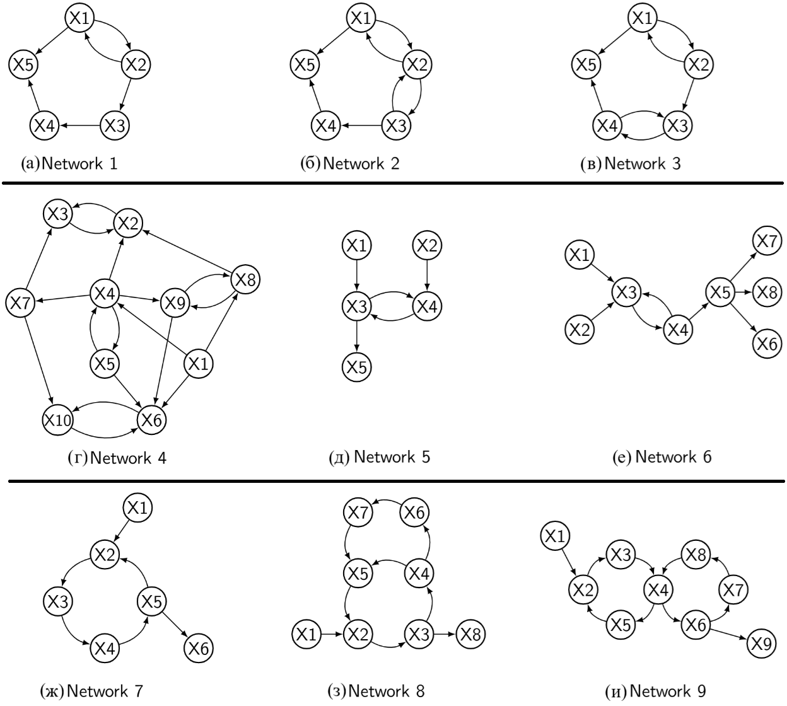
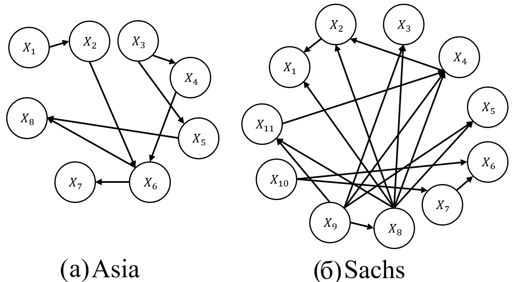
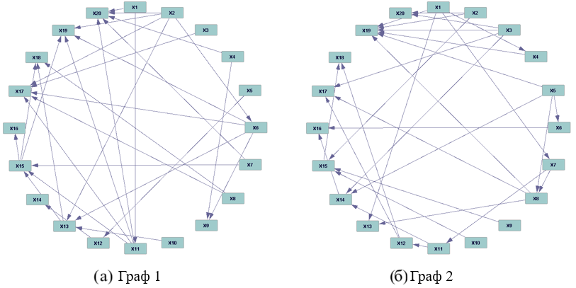

.. _datasets:

Обзор открытых данных для тестирования алгоритмов построения ПСГ
=======================================================================

Для тестирования и сравнения алгоритмов построения ПСГ необходимо иметь набор
входных переменных с некоторым набором наблюдений (исходные данные) и целевой граф.
В данном разделе мы используем термин «правильный ответ» для обозначения целевого графа.

.. important::

   Для синтетических тестовых наборов правильный ответ точно известен, поскольку схема
   построения набора основана на генерации данных в соответствии с заданным графом.
   В реальных задачах правильный ответ, как правило, соответствует наилучшему
   найденному приближению.

Алгоритмы построения ПСГ служат для создания наиболее вероятного кандидата на
правильный ответ. Заключение о физичности может быть дано только экспертом, но
подготовка одного или нескольких графов позволяет существенно сократить работу
высококвалифицированного эксперта: ответ на вопрос «разумна ли эта причинно-следственная
связь?» требует существенно меньше работы, чем запрос перечислить все
причинно-следственные связи в данном наборе данных.

Проблемы открытых наборов данных
------------------------------------------------------

В ходе интенсивного поиска открытых наборов данных для тестирования алгоритмов
построения ПСГ установлено **отсутствие единого подхода** к представлению таких наборов.
Более того, во многих случаях данные набора могут быть получены путём загрузки из
указанных источников, но для правильного ответа часто просто даются ссылки на статьи.

Например, ссылка на набор данных о профессиональном выгорании учителей в коллекции
тестовых наборов данных [benchCMU]:

    *Teacher Burnout data: check Fig.6.2 in BM Byrne 2013 for the hypothesized
    causal graph. Also check our papers GIN and TIN for results of learning
    latent variables on the dataset.*

Репозиторий Ramsey
------------------------------------------------------

Репозиторий [RamsleyGit] содержит две коллекции наборов данных — синтетические
и реальные.

Синтетические данные
~~~~~~~~~~~~~~~~~~~~~~~~~~~~~~~~~~

Синтетические данные включают два типа наборов:

- **feedback** — содержит 18 графов с 60 наборами по 500 наблюдений для каждого графа. Графы содержат от 5 до 10 вершин. Данные **не подходят** для исследований, поскольку все графы содержат циклы.

- **Car-evaluation** — один набор данных с 7 переменными и 1728 наблюдениями. Правильный ответ не определён.

   Истинные причинно-следственные графы для синтетического набора данных feedback

Реальные данные
~~~~~~~~~~~~~~~~~~~~~~~~~~~~~~~~~~

Реальные данные из этого репозитория содержат 39 наборов данных из различных областей.
К сожалению, все наборы данных содержат только **частичное описание**: указано некоторое
количество рёбер, которые не могут присутствовать в графе, но нет списка обязательных
рёбер.

Коллекция bnlearn_discrete_10000 (Causal learn)
------------------------------------------------------

Библиотека Causal learn [benchCMULib] содержит коллекцию тестовых множеств
``bnlearn_discrete_10000``, приведённую в таблице ниже.

.. _tab-bench-reviews:

.. list-table:: Тестовые наборы данных из коллекции bnlearn_discrete_10000
   :header-rows: 1
   :widths: 30 35 35

   * - Название
     - Число наблюдений
     - Число атрибутов
   * - alarm
     - 10 000
     - 37
   * - andes
     - 10 000
     - 223
   * - asia
     - 10 000
     - 8
   * - barley
     - 10 000
     - 48
   * - cancer
     - 10 000
     - 5
   * - child
     - 10 000
     - 20
   * - earthquake
     - 10 000
     - 5
   * - hailfinder
     - 10 000
     - 56
   * - hepar2
     - 10 000
     - 70
   * - insurance
     - 10 000
     - 27
   * - sachs
     - 10 000
     - 11
   * - survey
     - 10 000
     - 6
   * - water
     - 10 000
     - 32
   * - win95pts
     - 10 000
     - 76

Поскольку все наборы данных содержат одинаковое число наблюдений (10 000), можно
заключить, что эти базы данных синтетические или реальные, расширенные за счёт
генерации дополнительных наблюдений. Для всех наборов приведено описание истинного графа.

   Истинные причинно-следственные графы для наборов данных Asia и Sachs

Коллекция Tetrad (Causal learn)
------------------------------------------------------

Вторая, полностью синтетическая коллекция, включённая в библиотеку
Causal learn [benchCMULib] — **Tetrad** — содержит:

- 10 наборов данных с **дискретными** переменными
- 10 наборов с **непрерывными** переменными

Каждый набор содержит 20 переменных и 10 000 наблюдений. Эти наборы имеют
правильные решения.

   Истинные причинно-следственные графы для наборов данных 1 и 2 в коллекции Tetrad

Ограничения доступных наборов данных
------------------------------------------------------

Среди большого набора просмотренных тестовых наборов **большинство не имеет правильного
ответа**, что делает невозможным их использование для сравнения качества различных
методов и алгоритмов. Ярким примером является *"Infant Health and Development Program
(IHDP) data"* — существует много работ, использовавших этот набор, но ни одна не
содержит «истинного» графа.

Наборы данных для временных рядов
------------------------------------------------------

Для тестирования алгоритмов, предназначенных для идентификации причинно-следственных
связей во временных рядах, найдена работа Cheng et al. [cheng2023causaltime],
в которой представлено три тестовых набора:

.. list-table:: Наборы данных CausalTime
   :header-rows: 1
   :widths: 15 85

   * - Набор
     - Описание
   * - **Medical**
     - Медицинский: 480 наблюдений в 40 временных точках с 20 переменными и 20 синтетическими переменными
   * - **Traffic**
     - Напряжённость дорожного движения: 480 наблюдений в 40 временных точках с 20 переменными и 20 синтетическими переменными
   * - **PM2.5**
     - Загрязнение воздуха: 480 наблюдений в 40 временных точках с 36 переменными и 36 синтетическими переменными

.. note::

   Главное достоинство этих наборов — наличие истинного графа для верхнего левого
   квадранта матрицы смежности. Такое усечённое представление правильного ответа
   связано с тем, что только для синтетической части данных матрица связности
   действительно известна.
